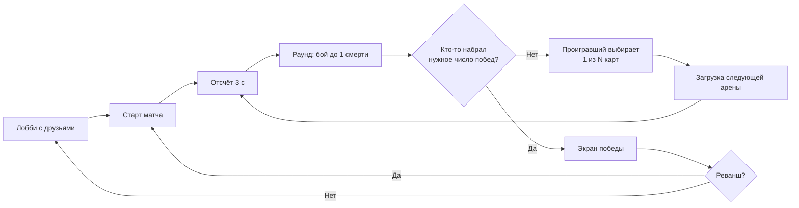
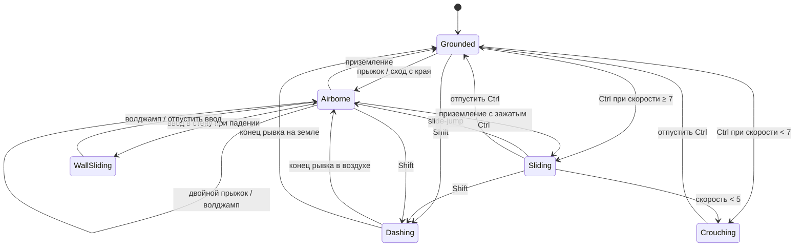
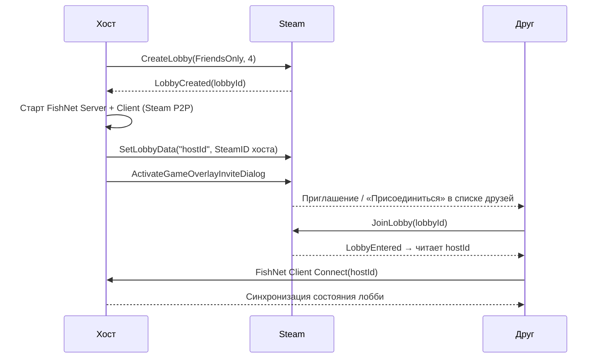
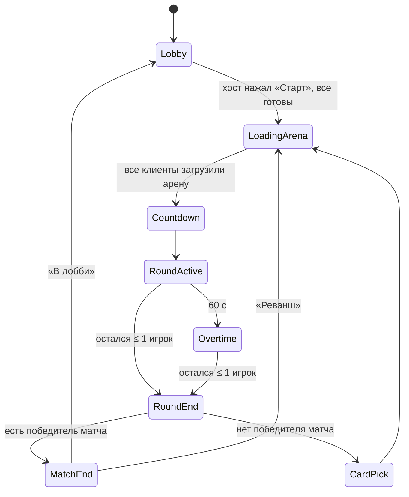

# AwesomeBalls — Game Design Document

> Версия 0.1 · 2026-10-10 · Статус: черновик для прототипирования
> Все числовые значения — **стартовые для тюнинга**, а не финальный баланс.

---

## Содержание

1. [Обзор](#1-обзор)
2. [Столпы дизайна](#2-столпы-дизайна)
3. [Core loop](#3-core-loop)
4. [Структура матча](#4-структура-матча)
5. [Мувмент](#5-мувмент)
6. [Бой](#6-бой)
7. [Система карт](#7-система-карт)
8. [Арены](#8-арены)
9. [Мультиплеер и сеть](#9-мультиплеер-и-сеть)
10. [UI/UX](#10-uiux)
11. [Арт и аудио](#11-арт-и-аудио)
12. [Управление](#12-управление)
13. [Техническая архитектура](#13-техническая-архитектура)
14. [Roadmap](#14-roadmap)
15. [Риски и открытые вопросы](#15-риски-и-открытые-вопросы)

---

## 1. Обзор

### 1.1. Pitch
**AwesomeBalls** — быстрый PvP-шутер от первого лица с элементами рогалика. Игроки сражаются короткими раундами до одной смерти. После каждого раунда **проигравший выбирает 1 из N карт-апгрейдов**, которые меняют оружие, снаряды, мувмент и защиту. К концу матча у каждого игрока собирается уникальный, часто абсурдный билд: рикошетящие разрывные пули, тройной прыжок, рывок, который бьёт врага.

Это **Rounds в 3D** с мувментом уровня Titanfall 2 / ULTRAKILL: подкаты, рывки, двойной прыжок, волджампы.

### 1.2. Ключевые характеристики

| | |
|---|---|
| Жанр | PvP arena FPS + roguelite (выбор апгрейдов между раундами) |
| Камера | От первого лица |
| Игроки | 1v1 (ядро), 2–4 FFA (расширение) |
| Платформа | PC (Windows), Steam |
| Мультиплеер | Только с друзьями Steam (лобби + инвайты), P2P через Steam Relay |
| Движок | Unity 6 (6000.5), URP, Input System |
| Длительность матча | 10–15 минут |
| Длительность раунда | 20–60 секунд |
| Модель | Премиум, низкая цена (ориентир $5–10) |

### 1.3. Референсы

| Игра | Что берём |
|---|---|
| **Rounds** | Структура матча, выбор карт проигравшим, блок как абилка, абсурдные синергии |
| **Titanfall 2** | Подкат + slide-jump, сохранение импульса, волджампы |
| **ULTRAKILL** | Рывки с зарядами, slam, «джус» мувмента |
| **Karlson / Dani-like** | Простая читаемая стилистика, физичный мувмент |
| **Risk of Rain 2** | Стакающиеся предметы, понятные числовые эффекты |

### 1.4. Чем отличаемся от Rounds (и что из этого следует)

| Проблема 3D | Решение |
|---|---|
| Целиться в 3D сложнее, чем в 2D | Снаряды быстрые и «толстые» (увеличенный хит-радиус), у игроков нет хедшотов |
| От первого лица не видно свой билд и билд врага | Билд читается **визуально**: цвет/размер/трейлы снарядов, размер игрока, ауры. Плюс панель карт по `Tab` |
| Арены больше, бой может затягиваться | Овертайм со сжимающейся зоной, арены компактные |
| Вертикальность | Карты на мувмент имеют реальный вес, арены строятся под волджампы и подкаты |

---

## 2. Столпы дизайна

1. **Мувмент — это навык.** Двигаться должно быть приятно даже без врага. Скилл игрока в мувменте даёт преимущество, сопоставимое с меткостью.
2. **Каждая карта ощутимо меняет игру.** Никаких «+3% урона». Взяв карту, игрок должен почувствовать разницу в первом же выстреле.
3. **Догоняющая механика.** Проигравший усиливается. Матч не решается после первых двух раундов, камбэки — норма.
4. **Короткие яркие раунды.** Одна жизнь, 20–60 секунд, мгновенный переход к следующему. Минимум времени вне боя.

---

## 3. Core loop



**Микро-цикл (секунды):** двигайся → найди угол атаки → стреляй/блокируй → уклоняйся мувментом.
**Мезо-цикл (раунд):** адаптируйся к новому билду противника и к новой арене.
**Макро-цикл (матч):** собери билд, который перекроет билд противника.

---

## 4. Структура матча

### 4.1. Параметры матча (настраиваются хостом в лобби)

| Параметр | По умолчанию | Варианты |
|---|---|---|
| Побед для выигрыша матча | 5 | 3 / 5 / 7 / 10 |
| Карт в выборе (N) | 5 | 3 / 4 / 5 |
| Время на выбор карты | 20 с | 10 / 20 / 30 / ∞ |
| Пул арен | Все | Выбор галочками |
| Овертайм | Вкл | Вкл / Выкл |
| Утешительная карта | Вкл | Вкл / Выкл |

### 4.2. Фазы раунда

| Фаза | Длительность | Что происходит |
|---|---|---|
| **Countdown** | 3 с | Игроки на спавнах, могут смотреть, но не двигаться/стрелять. Показ «3-2-1» |
| **Active** | до 60 с | Бой. У всех полные HP, патроны, заряды рывка, блок готов |
| **Overtime** | до 30 с | Зона-сфера сжимается от радиуса арены до 5 м. Вне зоны −15 HP/с. Сигнал звуком и цветом неба |
| **Round End** | 2 с | Финальный удар в замедлении (визуальное, см. 6.6), показ победителя раунда |
| **Card Pick** | до 20 с | Проигравший выбирает карту; в это время грузится следующая арена |

### 4.3. Правила победы
- **Раунд:** выигрывает последний выживший. 1 раунд = 1 очко.
- **Матч:** первый, кто набрал нужное число очков.
- **Ничья** (все оставшиеся погибли в один тик): раунд не засчитывается, карты не выдаются, раунд переигрывается на новой арене.
- **Смерть от окружения** (падение в пропасть, зона) засчитывается как обычная смерть.

### 4.4. Кто выбирает карты
- **1v1:** проигравший раунда.
- **FFA (3–4 игрока):** все, кроме победителя раунда. Выбирают **одновременно**, каждый из своего набора. Результаты выбора показываются всем после окончания фазы.
- **Утешительная карта:** игрок, проигравший 3 раунда подряд, получает в следующем наборе гарантированную карту редкости Rare или выше.
- Победитель раунда **ничего не получает** — это главный анти-снежный-ком механизм.

### 4.5. Целевая длина
- Раунд: 20–60 с, медиана ~35 с.
- Матч до 5 побед в 1v1: 5–9 раундов → **8–12 минут** с учётом выбора карт.

---

## 5. Мувмент

Мувмент — главная фича игры. Цель: **плавный, отзывчивый, с сохранением импульса**, где опытный игрок движется заметно быстрее новичка, но новичок не чувствует себя беспомощным.

### 5.1. Общие принципы
- **Импульс сохраняется.** Скорость выше базовой не обрезается мгновенно, а плавно гасится трением только на земле.
- **Мгновенный отклик на ввод.** Высокое ускорение на земле, coyote time и буфер прыжка.
- **Ресурсы восстанавливаются.** Двойной прыжок восстанавливается при касании земли или волджампе, рывки перезаряжаются по таймеру.
- **Без штрафа за движение к точности.** Разброс не растёт в движении: стрелять на скорости — это норма, а не ошибка.
- **Фиксированный тик симуляции 60 Гц** (детерминизм для сетевого предсказания, см. раздел 9). Камера и модель интерполируются между тиками.

### 5.2. Базовое движение

| Параметр | Значение | Комментарий |
|---|---|---|
| Скорость бега | 9 м/с | Бег по умолчанию, отдельного спринта нет |
| Скорость в приседе | 4.5 м/с | |
| Ускорение на земле | 80 м/с² | ~0.11 с до максимальной скорости |
| Торможение без ввода | 60 м/с² | |
| Трение избыточной скорости (выше бега) | 12 м/с² | Плавно гасит скорость после подката/рывка |
| Ускорение в воздухе | 25 м/с² | |
| Air control | до 9 м/с | Ввод в воздухе не разгоняет выше скорости бега, но и не режет текущий импульс |
| Гравитация | 28 м/с² | Сильнее реальной ради «плотных» прыжков |
| Множитель гравитации при падении | 1.25 | Быстрее вниз, чем вверх |
| Макс. скорость падения | 45 м/с | |
| Жёсткий лимит горизонтальной скорости | 35 м/с | Защита от эксплойтов |
| Макс. уклон для ходьбы | 50° | |
| Высота ступеньки | 0.4 м | |

### 5.3. Прыжок

| Параметр | Значение |
|---|---|
| Высота прыжка | 1.5 м (v₀ ≈ 9.2 м/с) |
| Coyote time | 0.12 с после схода с края |
| Jump buffer | 0.12 с до приземления |
| Bhop window | 0.1 с: прыжок в этом окне после приземления не теряет скорость на трение |
| Переменная высота | Отпустить прыжок на подъёме → вертикальная скорость ×0.5 (короткий прыжок) |

### 5.4. Двойной прыжок

| Параметр | Значение |
|---|---|
| Зарядов в воздухе | 1 (карты добавляют) |
| Высота | 1.2 м (v ≈ 8.2 м/с) |
| Вертикальная скорость | **Устанавливается**, а не прибавляется (падение не «съедает» прыжок) |
| Смена направления | Если есть ввод — горизонтальная скорость поворачивается к направлению ввода на угол до 60°, модуль ×0.95 |
| Восстановление | Касание земли или волджамп |

**Фил:** короткий «пуф» VFX под ногами, лёгкий кик камеры вверх, отдельный звук (отличимый от обычного прыжка — враг должен слышать, что ты потратил двойной прыжок).

### 5.5. Рывок (Dash)

| Параметр | Значение |
|---|---|
| Зарядов | 2 |
| Перезарядка | 1.5 с на заряд (последовательно) |
| Мин. интервал между рывками | 0.2 с |
| Длительность | 0.14 с |
| Скорость во время рывка | 32 м/с (≈4.5 м дистанция) |
| Скорость на выходе | max(текущая горизонтальная скорость в направлении рывка, 13 м/с) |
| Направление | Направление ввода относительно камеры (только горизонталь). Без ввода — вперёд по взгляду |
| В воздухе | Вертикальная скорость обнуляется, гравитация отключена на время рывка |
| Неуязвимость | **Нет.** Защита — это блок (6.4), рывок — это позиционирование |

**Взаимодействия:**
- Рывок из подката разрешён (подкат прерывается, скорость сохраняется).
- Рывок → прыжок в течение 0.1 с после окончания = «dash-jump»: сохраняет выходную скорость рывка.
- Рывок в стену → можно сразу сделать волджамп.

**Фил:** FOV-кик +6° на 0.15 с, speed lines, короткий whoosh, индикатор зарядов в HUD.

### 5.6. Подкат (Slide)

| Параметр | Значение |
|---|---|
| Ввод | Удерживать `Ctrl`/`C` (в настройках — режим toggle) |
| Условие старта | На земле и горизонтальная скорость ≥ 7 м/с. Иначе — обычный присед |
| Буст на входе | +5 м/с, но не выше 18 м/с итого |
| Кулдаун буста | 1.2 с (подкат без буста доступен всегда) — против спама «подкат-прыжок-подкат» |
| Трение в подкате | 4 м/с² на ровной поверхности |
| Склоны | Ускорение вниз по склону = g·sin(угол) (на склоне 20° ≈ +9.6 м/с²) |
| Управление | Поворот до 120°/с |
| Высота капсулы | 1.8 → 0.9 м |
| Высота камеры | 1.6 → 0.8 м (сглаживание 0.1 с) |
| Выход | Отпустить кнопку (если есть место над головой), скорость < 5 м/с → присед, прыжок → slide-jump |
| Slide-jump | Сохраняет 100% горизонтальной скорости, обычная высота прыжка |
| Приземление в подкат | Если кнопка зажата при приземлении со скоростью падения > 10 м/с — 40% вертикальной скорости конвертируется в горизонтальную |

**Фил:** камера опускается и наклоняется на 3° в сторону поворота, звук скольжения с питчем от скорости, искры/пыль из-под персонажа.

### 5.7. Волджамп (Wall Jump)

| Параметр | Значение |
|---|---|
| Детекция стены | Поверхность с нормалью в пределах ±25° от горизонтали, в пределах 0.35 м от капсулы |
| Условие | В воздухе, ≥ 0.1 с после отрыва от земли |
| Приоритет | Прыжок у стены = волджамп (двойной прыжок не тратится) |
| Скорость | Горизонталь: нормаль стены × 8 м/с + 90% тангенциальной составляющей текущей скорости + 30% смещение в сторону ввода. Вертикаль: 9.2 м/с |
| Восстанавливает | 1 заряд двойного прыжка (рывки — нет) |
| Ограничение «та же стена» | Нельзя дважды подряд оттолкнуться от той же плоскости (нормаль отличается < 30° и точка касания ближе 2 м), пока не коснёшься земли или другой стены |
| Затухание цепочки | Каждый следующий волджамп без касания земли: вертикальная скорость −10% (минимум 60%) |

Зигзаг между двумя параллельными стенами разрешён и поощряется, это основной способ подняться вверх.

**Скольжение по стене (Wall Slide):** если в падении зажат ввод в сторону стены, скорость падения ограничена 5 м/с на 0.6 с. Это даёт время на решение. Камера наклоняется на 5° от стены.

**Фил:** глухой «тук» с материалом стены, пыль на стене, кик камеры от стены.

### 5.8. Мантлинг (желательно, stretch-цель M1)
Если в воздухе есть ввод вперёд и перед игроком уступ, верх которого не выше 1.3 м над ногами, игрок автоматически забирается на уступ за 0.25 с с сохранением 70% горизонтальной скорости. Убирает фрустрацию «почти допрыгнул».

### 5.9. Камера и «джус»

| Эффект | Значение | Можно отключить |
|---|---|---|
| Базовый FOV | 90° (настройка 70–120) | — |
| Динамический FOV | +0…+10° при скорости 9→25 м/с | Да |
| FOV-кик при рывке | +6° на 0.15 с | Да |
| Наклон при подкате | 3° | Да |
| Наклон при скольжении по стене | 5° | Да |
| Просадка при приземлении | До 0.15 м, пружина, зависит от скорости падения | Да |
| Speed lines | При скорости > 18 м/с | Да |
| Head bob | Выключен по умолчанию | — |

Все эффекты наклона/тряски вынесены в настройку «Укачивание: снизить эффекты камеры».

### 5.10. Состояния мувмента



### 5.11. Критерии «мувмент готов»
- Полигон-трасса из 10 участков (подъём волджампами, спуск подкатом, разрыв через рывок + двойной прыжок) проходится новичком за ≤ 60 с, а опытным — за ≤ 25 с.
- На скорости 25+ м/с нет дрожания камеры и застреваний на рёбрах геометрии.
- Плейтестеры без подсказок пробуют slide-jump и цепочки волджампов в первые 5 минут.

---

## 6. Бой

### 6.1. Игрок

| Параметр | Значение |
|---|---|
| HP | 100 |
| Регенерация | Нет (только картами) |
| Хитбокс | Капсула (высота 1.8 / 0.9 в подкате, радиус 0.45) |
| Хедшоты | **Нет.** В 3D с быстрым мувментом это слишком сильно штрафует. Крит — только через карты |
| Урон от своих взрывов | 50% (позволяет rocket jump с картой «Разрывные») |

### 6.2. Базовое оружие — «Бластер»
Как и в Rounds, у всех **одно базовое оружие**. Вся вариативность — из карт.

| Параметр | Значение |
|---|---|
| Урон | 20 (5 попаданий до убийства) |
| Скорострельность | 4 выстрела/с, автоматический огонь при удержании |
| Магазин | 6 |
| Перезарядка | 1.5 с (автоматически при пустом, вручную по `R`) |
| Тип | **Физический снаряд** (не хитскан) |
| Скорость снаряда | 90 м/с |
| Радиус снаряда (хит) | 0.12 м |
| Гравитация снаряда | 0 |
| Время жизни снаряда | 2 с |
| Отскоков | 0 |
| Разброс | 0.6° (не растёт в движении) |
| Отталкивание при попадании | 3 м/с |
| Отдача | Только визуальная (кик камеры, возврат за 0.1 с), прицел не сбивается |

**Почему снаряды, а не хитскан:** большинство самых интересных карт (рикошет, самонаведение, разрывные, шрапнель, гравитация) естественно работают только со снарядами. Плюс снаряды дают контригру через мувмент — от них можно увернуться.

**TTK:** идеальный — 1.0 с. Реальный, с учётом промахов и мувмента — 2–5 с. Это оставляет время на реакцию блоком и мувментом.

### 6.3. Перезарядка и патроны
- Патроны бесконечные, ограничение только магазином.
- Перезарядку можно прервать рывком/подкатом **без сброса**: прогресс перезарядки продолжается.
- В HUD патроны отображаются точками у прицела.

### 6.4. Блок
Защитная абилка, аналог блока из Rounds. Вокруг неё строится целая категория карт.

| Параметр | Значение |
|---|---|
| Ввод | ПКМ |
| Длительность | 0.3 с |
| Кулдаун | 4 с |
| Эффект | Полностью гасит урон и негативные эффекты (яд, замедление, отталкивание) в окне |
| Ограничения | Во время блока можно двигаться, нельзя стрелять |
| Читаемость | Видимая сфера-щит цвета игрока + отчётливый звук. Противник должен понимать, что блок потрачен |

### 6.5. Урон от окружения
- Падение за нижнюю границу арены — мгновенная смерть.
- Урон от падения — **нет** (не наказываем мувмент).
- Опасные зоны (лава/электричество на отдельных аренах) — 40 HP/с.
- Зона овертайма — 15 HP/с.

### 6.6. Фидбек боя
- **Попадание:** хитмаркер, звук «динь» с питчем от урона, числа урона (настройка), вспышка на противнике.
- **Получение урона:** направленный индикатор, красная виньетка, глухой звук.
- **Убийство (конец раунда):** локальное визуальное замедление на 0.4 с (time-scale эффектов, камеры и анимаций, но не симуляции — сеть не останавливается), характерный звук, фокус камеры победителя.
- **Блок попадания:** звук удара по щиту у обоих игроков.

---

## 7. Система карт

### 7.1. Правила выбора

| Правило | Значение |
|---|---|
| Карт в наборе | N = 5 (настройка 3–5) |
| Повторы в одном наборе | Нет |
| Редкость | Взвешенный случайный выбор по весам (см. ниже) |
| Гарантия | Минимум 1 карта Uncommon+ в наборе |
| Утешение | После 3 поражений подряд — минимум 1 карта Rare+ |
| Таймаут | При истечении времени выбирается случайная карта из набора |
| Видимость | Противник видит набор и **на какую карту наведён курсор** выбирающего (как в Rounds — это создаёт напряжение и разговоры) |
| Стаки | Большинство карт стакаются. У части есть лимит (`maxStacks`) или они уникальны |
| Исключения | Карты могут исключать друг друга по тегам (напр. «Снайпер» и «Скорострел» допустимы, а «Кровавые патроны» исключают «Расширенный магазин») |
| Сид | Наборы генерирует хост, сид раунда синхронизирован |

**Веса редкостей:**

| Редкость | Вес | Цвет рамки |
|---|---|---|
| Common | 55 | Серый |
| Uncommon | 30 | Зелёный |
| Rare | 12 | Синий |
| Legendary | 3 | Золотой |

### 7.2. Формула статов
Для каждого стата:

```
final = (base + Σ add) × (1 + Σ percent) × Π mult
```

- `add` — плоская прибавка (напр. +3 патрона).
- `percent` — процентные модификаторы складываются между собой (две карты «+50% скорострельности» = +100%).
- `mult` — редкие сильные множители, перемножаются (Legendary-карты, «Стеклянная пушка»).

**Клампы (защита от поломки игры):**

| Стат | Мин | Макс |
|---|---|---|
| Скорострельность | 0.5/с | 20/с |
| Снарядов за выстрел | 1 | 12 |
| Магазин | 1 | 60 |
| Перезарядка | 0.2 с | 5 с |
| Размер игрока | ×0.5 | ×2 |
| Макс. HP | 10 | 500 |
| Скорость бега | 5 м/с | 18 м/с |

### 7.3. Категории
- 🔫 **Оружие** — урон, скорострельность, магазин, перезарядка.
- 💥 **Снаряды** — поведение снаряда: отскоки, взрывы, наведение, эффекты при попадании.
- 🏃 **Мувмент** — прыжки, рывки, подкаты, новые способности мувмента.
- 🛡️ **Защита** — HP, регенерация, размер, снижение урона.
- 🔰 **Блок** — модификаторы блока.
- ☠️ **Проклятые** — сильный плюс с заметным минусом.

### 7.4. Стартовый список карт (48)
Колонка **MVP** — 15 карт для первого играбельного билда (Milestone 4).

#### 🔫 Оружие

| # | Карта | Редкость | Эффект | Стак | MVP |
|---|---|---|---|---|---|
| 1 | Большие пули | Common | Урон +30%, размер снаряда +50%, скорость снаряда −10% | ∞ | ✅ |
| 2 | Скорострел | Common | Скорострельность +50%, урон −20% | ∞ | ✅ |
| 3 | Расширенный магазин | Common | +3 патрона, перезарядка +0.25 с | ∞ | |
| 4 | Быстрые руки | Common | Перезарядка −35% | 3 | ✅ |
| 5 | Снайпер | Uncommon | Урон +80%, скорость снаряда +100%, скорострельность −40%, магазин −2 | 3 | ✅ |
| 6 | Дробовик | Uncommon | +2 снаряда за выстрел (веер 6°), урон каждого −40% | ∞ | ✅ |
| 7 | Очередь | Uncommon | Выстрел = очередь из 3 снарядов за 1 патрон, урон −50% | 2 | |
| 8 | Последний патрон | Uncommon | Последний патрон в магазине наносит ×3 урона | 1 | |
| 9 | Пробитие | Uncommon | Снаряды проходят сквозь 1 стену толщиной до 1 м | 3 | |
| 10 | Разгон | Common | Снаряды разгоняются ×2 за 0.5 с; урон +1% за метр полёта (до +60%) | 1 | |

#### 💥 Снаряды

| # | Карта | Редкость | Эффект | Стак | MVP |
|---|---|---|---|---|---|
| 11 | Рикошет | Common | +2 отскока от поверхностей, +10% урона за каждый отскок | ∞ | ✅ |
| 12 | Разрывные | Uncommon | Взрыв r = 2 м, 40% урона по площади, отталкивание (в т.ч. себя — rocket jump) | ∞ (+0.5 м радиуса) | ✅ |
| 13 | Самонаведение | Rare | Снаряды доворачивают на цель в конусе 25° (90°/с) | 3 | |
| 14 | Тяжёлые снаряды | Common | Снаряды летят по баллистике, урон +40%, отталкивание +100% | 2 | |
| 15 | Отталкивание | Common | Отталкивание при попадании ×3 | ∞ | ✅ |
| 16 | Яд | Uncommon | Попадание: +30% урона ядом за 3 с, стакается | ∞ | |
| 17 | Холод | Uncommon | Попадание: замедление −25% на 1.5 с, рывок блокируется на 0.5 с | 2 | |
| 18 | Вампиризм | Uncommon | Лечит 35% нанесённого урона | ∞ | ✅ |
| 19 | Шрапнель | Uncommon | При попадании в поверхность снаряд распадается на 3 осколка по 25% урона | ∞ | |
| 20 | Чёрная дыра | Legendary | Каждый 4-й снаряд создаёт сингулярность на 1.5 с, притягивает игроков в радиусе 6 м | 1 | |
| 21 | Цепная молния | Rare | Попадание перескакивает на ближайшего другого врага в радиусе 8 м (50% урона). В 1v1 — бьёт по врагу повторно через 0.5 с (25%) | 2 | |

#### 🏃 Мувмент

| # | Карта | Редкость | Эффект | Стак | MVP |
|---|---|---|---|---|---|
| 22 | Тройной прыжок | Uncommon | +1 прыжок в воздухе | ∞ | ✅ |
| 23 | Лишний рывок | Common | +1 заряд рывка | 3 | ✅ |
| 24 | Реактивные сопла | Common | Перезарядка рывка −30% | 3 | |
| 25 | Таран | Uncommon | Рывок сквозь врага наносит 40 урона и отталкивает его | ∞ (+40) | |
| 26 | Скороход | Common | Скорость бега +15%, ускорение +20% | 3 | |
| 27 | Паркурщик | Uncommon | Открывает бег по стене (до 1.2 с); волджамп не теряет скорость | 1 | |
| 28 | Подкат-мина | Uncommon | В конце подката остаётся мина (3 с, 50 урона, r = 2.5 м) | ∞ | |
| 29 | Удар с неба | Uncommon | `Ctrl` в воздухе — резкое падение 40 м/с; при приземлении волна r = 4 м, 35 урона и подброс. Прыжок сразу после удара — высокий прыжок | 1 | |
| 30 | Крюк-кошка | Legendary | Новая способность на `E`: крюк до 30 м, кулдаун 5 с | 1 | |
| 31 | Кинетик | Rare | Урон +3% за каждый м/с скорости выше 9 (до +60%) | 1 | |
| 32 | Лунные ботинки | Common | Гравитация −30% (выше прыжки, но медленнее падаешь — легче попасть) | 2 | |
| 33 | Свободный рывок | Uncommon | Рывок учитывает наклон камеры (можно рвануть вверх/вниз) | 1 | |

#### 🛡️ Защита

| # | Карта | Редкость | Эффект | Стак | MVP |
|---|---|---|---|---|---|
| 34 | Толстокожий | Common | +40 макс. HP, скорость −5% | ∞ | ✅ |
| 35 | Регенерация | Common | После 3 с без урона: +8 HP/с | ∞ | ✅ |
| 36 | Гигант | Uncommon | Макс. HP ×2, размер ×1.4, скорость −10% | 2 | |
| 37 | Малыш | Uncommon | Размер ×0.7, макс. HP −30%, скорость +10% | 2 | |
| 38 | Феникс | Legendary | Один раз за раунд: при смерти воскреснуть через 2 с с 50% HP | 1 | |
| 39 | Кинетическая броня | Uncommon | Входящий урон −25% при скорости > 14 м/с | 2 | |

#### 🔰 Блок

| # | Карта | Редкость | Эффект | Стак | MVP |
|---|---|---|---|---|---|
| 40 | Быстрый блок | Common | Кулдаун блока −30% | 3 | ✅ |
| 41 | Зеркало | Rare | Блок отражает снаряды обратно в атакующего | 1 | |
| 42 | Блок-рывок | Uncommon | Блок восстанавливает 1 заряд рывка и даёт импульс 12 м/с в сторону ввода | 1 | |
| 43 | Ударная волна | Uncommon | Блок выпускает волну r = 5 м: 15 урона + сильное отталкивание | ∞ | |
| 44 | Тактическая перезарядка | Common | Блок мгновенно перезаряжает оружие | 1 | |

#### ☠️ Проклятые

| # | Карта | Редкость | Эффект | Стак | MVP |
|---|---|---|---|---|---|
| 45 | Стеклянная пушка | Rare | Урон ×2, макс. HP ×0.5 | 2 | ✅ |
| 46 | Берсерк | Rare | Чем меньше HP, тем выше скорострельность (до +100%) и скорость (до +30%). Регенерация от любых карт −50% | 1 | |
| 47 | Кровавые патроны | Rare | Нет магазина и перезарядки, каждый выстрел стоит 4 HP. Исключает «Расширенный магазин», «Быстрые руки» | 1 | |
| 48 | Призрак | Rare | Во время подката и 0.5 с после — 75% прозрачности. Макс. HP −20 | 1 | |

> Итого 48 карт, из них 15 — MVP. Новые карты добавляются в первую очередь через комбинацию существующих модификаторов и хуков (см. 7.5), без нового кода.

### 7.5. Архитектура карт (данные)

```
CardDefinition (ScriptableObject)
├── id, displayName, description, icon
├── rarity, category, tags[]
├── maxStacks, excludesTags[]
├── statModifiers[]   // { stat, type: Add|Percent|Mult, value }
└── effects[]         // [SerializeReference] CardEffect — логика на событиях
```

**События (хуки) для `CardEffect`:**

| Событие | Примеры карт |
|---|---|
| `OnShoot(shot)` | Очередь, Дробовик, Чёрная дыра (счётчик) |
| `OnProjectileHit(hit)` | Яд, Холод, Вампиризм, Цепная молния |
| `OnProjectileBounce(hit)` | Рикошет, Шрапнель |
| `OnProjectileTick(projectile)` | Самонаведение, Разгон |
| `OnDamageTaken(info)` | Кинетическая броня, Берсерк |
| `OnDeath()` | Феникс |
| `OnBlock()` | Зеркало, Блок-рывок, Ударная волна, Тактическая перезарядка |
| `OnDash()` / `OnDashHit(target)` | Таран |
| `OnSlideStart()` / `OnSlideEnd()` | Подкат-мина, Призрак |
| `OnLand(fallSpeed)` | Удар с неба |
| `OnReload()` / `OnLastBullet()` | Последний патрон |
| `OnRoundStart()` | Сброс счётчиков, Феникс |

**Сеть:** карта идентифицируется индексом в `CardDatabase`. По сети передаётся только «игрок X взял карту #Y». Все клиенты применяют её детерминированно.

### 7.6. Читаемость билда
- **Снаряды** меняют вид от карт: размер (Большие пули), цвет-эффект (Яд — зелёный, Холод — голубой), трейл (Самонаведение), искры (Рикошет).
- **Игрок** меняет размер (Гигант/Малыш) и получает ауры (Регенерация, Кинетическая броня).
- **Панель по `Tab`:** карты всех игроков с иконками и стаками.
- **В HUD** — компактная строка иконок своих карт и карт противника (1v1).

### 7.7. Принципы баланса
- **Нет мусорных карт.** Если карту никто не берёт — её усиливают или переделывают.
- **Контригра.** Почти на каждую сильную стратегию есть ответ (самонаведение ← блок/мувмент, Гигант ← урон по площади, Стеклянная пушка ← Вампиризм/давление).
- **Телеметрия плейтестов:** частота выбора, винрейт после взятия, средняя длина раунда. Ведём таблицу.

---

## 8. Арены

### 8.1. Принципы левел-дизайна
- **Под мувмент:**
  - пары параллельных стен высотой ≥ 3 м на расстоянии 4–7 м — коридоры для цепочек волджампов;
  - склоны 15–30° — разгон подкатом;
  - разрывы 6–10 м — проходятся рывком + двойным прыжком.
- **Вертикальность:** минимум 2–3 уровня высоты. Верх должен быть достижим без джамп-пада, но с джамп-падом — быстрее.
- **Линии видимости:** нет открытых прострелов длиннее 40 м без укрытия. Укрытия через каждые 8–12 м.
- **Компактность:** 1v1 — ~40×40 м, FFA — ~60×60 м. Встреча игроков в первые 5–8 секунд раунда.
- **Симметрия:** для 1v1 — зеркальная или вращательная симметрия. Для FFA — 4 спавна по кругу.
- **Читаемость:** контрастные цвета для стен, по которым можно прыгать, и для опасных зон. Простая геометрия без мелкой коллизии (о неё ломается мувмент).
- **Без урона от падения**, но с пропастями на отдельных аренах.

### 8.2. Ротация
Каждый раунд — **случайная арена из пула** без повтора двух подряд. Арена грузится аддитивной сценой во время выбора карты.

### 8.3. Стартовые арены

| Арена | Размер | Особенности | Игроки |
|---|---|---|---|
| **Склад** | 40×40 м | Контейнеры в 2 яруса, узкие проходы-«колодцы» для волджампов, рампы | 1v1 |
| **Скейтпарк** | 45×45 м | Чаши и халф-пайпы для подкатов, центральная башня | 1v1, FFA |
| **Башни** | 40×40 м, 3 уровня | Вертикальная, джамп-пады, мосты между башнями, пропасть снизу | 1v1 |
| **Кузня** | 60×60 м | Лавовые каналы (опасная зона), движущиеся платформы | FFA |

### 8.4. Пайплайн
1. Грейбокс в ProBuilder с метриками (стандартные кубы 1/2/4 м, контрольные стены для волджампа).
2. Плейтест мувмента на грейбоксе.
3. Арт-проход модульным китом.
4. Финальная проверка коллизии (без мелких рёбер и щелей).

---

## 9. Мультиплеер и сеть

### 9.1. Стек

| Компонент | Выбор |
|---|---|
| Netcode | **FishNet** (бесплатный, open source) |
| Транспорт | **FishySteamworks** (официальный Steam-транспорт FishNet поверх Steamworks.NET) |
| Steam API | **Steamworks.NET** |
| Топология | Host-client (listen server): один из игроков — хост |
| Соединение | Steam P2P через Steam Datagram Relay — без проброса портов, IP скрыты |
| App ID | В разработке — 480 (Spacewar), до релиза — собственный App ID (Steam Direct) |

**Почему FishNet:**
- Встроенное клиентское предсказание и реконсиляция (Replicate/Reconcile) — критично для отзывчивого мувмента у не-хоста.
- Готовый Steam-транспорт.
- Бесплатный, активно поддерживается, большое сообщество.

**Почему не альтернативы:**
- **Netcode for GameObjects** — нет полноценного client-side prediction из коробки, его пришлось бы писать вручную.
- **Mirror** — prediction тоже нужно писать самостоятельно, развитие проекта замедлилось.

### 9.2. Лобби и друзья (Steam)



- Тип лобби: **Friends Only** (или Invite Only — настройка).
- Входы в игру: инвайт через оверлей Steam, кнопка «Присоединиться» в списке друзей (`GameLobbyJoinRequested`), запуск игры по инвайту (аргумент `+connect_lobby`).
- **Rich Presence:** статус «В лобби (2/4)» / «Матч: 3–2».
- Лобби показывает аватары и имена из Steam, статус готовности, настройки матча (меняет только хост).

### 9.3. Авторитет и синхронизация

| Что | Как |
|---|---|
| Тик симуляции | 60 Гц (TimeManager FishNet) |
| Мувмент | Client-side prediction + server reconcile. Ввод упакован в структуру (move, yaw/pitch, кнопки с буфером), симуляция детерминирована в пределах тика |
| Стрельба | Клиент мгновенно спавнит **визуальный** снаряд и отправляет `Fire(tick, origin, direction)`. Хост спавнит авторитетный снаряд с «догоном» на величину задержки, остальные клиенты — тоже с догоном |
| Попадания | Считает хост. При необходимости — rollback коллайдеров (проверить доступность компенсации лагов в используемой версии FishNet) |
| HP, смерть, очки | Только хост, рассылка клиентам |
| Карты | Хост генерирует наборы (сид раунда), выбирающий отправляет выбор, хост рассылает «игрок X взял карту Y» |
| Состояние матча | Стейт-машина на хосте, клиенты получают текущую фазу и таймер |
| Загрузка арен | Хост командует загрузить сцену (SceneManager FishNet), раунд стартует, когда все загрузились (таймаут 15 с) |

### 9.4. Стейт-машина матча (хост)



### 9.5. Отключения
- **Клиент вышел:** в 1v1 — победа оставшемуся, возврат в лобби. В FFA — игрок убирается, матч продолжается.
- **Хост вышел:** матч завершается, все возвращаются в главное меню с сообщением. Миграция хоста — вне scope MVP.
- **Переподключение** — вне scope MVP.

### 9.6. Античит
Не делаем: игра только с друзьями. Хост-авторитет защищает от самых грубых вещей (телепорты, бесконечное HP у клиента).

---

## 10. UI/UX

### 10.1. Экраны
1. **Главное меню:** Играть (создать лобби), Настройки, Выход. Фоном — арена с летающими снарядами.
2. **Лобби:** 4 слота с аватарами Steam, «Пригласить друга» (оверлей Steam), готовность, настройки матча (только хост), «Старт».
3. **Загрузка/Отсчёт:** название арены, крупное «3-2-1».
4. **HUD** (см. 10.2).
5. **Выбор карт:** N карт веером, анимация раздачи, наведение — карта поднимается и увеличивается. Таймер. Победитель раунда видит те же карты и курсор выбирающего.
6. **Победа в матче:** победитель, итоговые билды всех игроков, кнопки «Реванш» / «В лобби».
7. **Пауза** (`Esc`): настройки, выход в лобби/меню. Игра не останавливается.
8. **Настройки:** чувствительность, FOV, инверсия, бинды, toggle/hold для подката, эффекты камеры, громкость (общая/музыка/эффекты), графика.

### 10.2. HUD

```
┌──────────────────────────────────────────────┐
│               [ 3 ] ★★★☆☆ : ★★☆☆☆ [ 2 ]      │  ← счёт раундов
│                                    0:42      │  ← таймер раунда
│                                              │
│                     ·  ┼  ·                  │  ← прицел + точки патронов
│                    ●●●●○○                    │
│                                              │
│ [иконки карт]                 [◆◆] рывки     │
│ ████████████░░ 85 HP          (◔) блок       │
│                               ↑ двойной прыжок│
└──────────────────────────────────────────────┘
```

- Минималистичный. Ключевая информация — у прицела (патроны) и в углах.
- Индикатор двойного прыжка — простая иконка (горит/не горит).
- HP противника в 1v1 — **не показывается** числом, только вспышка при попадании (по `Tab` видно его карты).

### 10.3. Онбординг
- Опциональный **тренировочный полигон** (оффлайн): трасса мувмента с подсказками + манекены для стрельбы.
- Подсказки биндов при первом запуске.

---

## 11. Арт и аудио

### 11.1. Визуальный стиль
- **Стилизованный low-poly, яркие плоские цвета, сильный контраст.** Быстро производить и легко читать на скорости.
- **Персонажи — «шары»** (по названию проекта): тело-шар с глазами, оружие «парит» рядом. Упрощает анимацию (squash & stretch вместо скелета), хорошо читается издалека. В подкате шар сплющивается. Хитбокс при этом — капсула (см. 6.1).
- **Цвета игроков:** красный, синий, зелёный, жёлтый. Снаряды, щит и эффекты — в цвете игрока.
- **Арены:** нейтральные приглушённые тона, чтобы игроки и снаряды были самыми яркими объектами в кадре.
- **Пост-эффекты (URP):** лёгкий bloom на снарядах, виньетка урона, speed lines. Без motion blur по умолчанию.
- **Вид от 1 лица:** видна рука/оружие-бластер, при рывке и подкате — анимация оружия.

### 11.2. Аудио
- **Мувмент:** шаги с частотой от скорости, нарастающий шум ветра от скорости, отдельные звуки прыжка/двойного прыжка/рывка/подката/волджампа. Звуки мувмента противника — пространственные и **хорошо слышимые** (это часть информации в бою).
- **Бой:** выстрел меняется от карт (тяжёлые — ниже, скорострел — короче), хитмаркер, блок, взрывы.
- **Музыка:** энергичная электроника в бою, спокойный луп на экране выбора карт, джингл победы.

---

## 12. Управление

Основано на `Assets/InputSystem_Actions.inputactions`. Существующие действия переназначаются: `Sprint` → `Dash`, `Crouch` → `Slide`, `Interact` → `Ability`. Нужно добавить `Block`, `Reload`, `Scoreboard`.

| Действие | Клавиатура/мышь | Геймпад |
|---|---|---|
| Движение | WASD | Левый стик |
| Обзор | Мышь | Правый стик |
| Прыжок / двойной / волджамп | Space | A |
| Рывок | Shift | RB |
| Подкат / присед | Ctrl или C | B / L3 |
| Огонь | ЛКМ | RT |
| Блок | ПКМ | LT |
| Перезарядка | R | X |
| Способность (из карт) | E | Y |
| Карты игроков | Tab | View/Select |
| Пауза | Esc | Menu/Start |

Все бинды переназначаются в настройках.

---

## 13. Техническая архитектура

### 13.1. Структура проекта

```
Assets/_Project/
├── Scripts/
│   ├── Core/          // Bootstrap, сервисы, события, утилиты
│   ├── Movement/      // PlayerMotor, MovementSettings, состояния
│   ├── Combat/        // Weapon, Projectile, Health, Block, Damage
│   ├── Stats/         // StatsContainer, StatModifier
│   ├── Cards/         // CardDefinition, CardEffect, CardDatabase, CardOfferService
│   ├── Match/         // MatchStateMachine, RoundManager, ArenaManager
│   ├── Networking/    // SteamLobbyService, FishNet-обвязка
│   └── UI/
├── Data/
│   ├── Cards/         // ассеты CardDefinition
│   └── Settings/      // MovementSettings, WeaponSettings, MatchSettings
├── Prefabs/
├── Scenes/            // Bootstrap, MainMenu, Lobby, Arena_*, Playground
├── Art/
└── Audio/
```

Каждая папка `Scripts/*` — отдельный Assembly Definition. Зависимости направлены строго вниз: `UI → Match → Cards → Combat/Movement → Stats → Core`.

### 13.2. Ключевые системы

| Система | Ответственность |
|---|---|
| `PlayerMotor` | Мувмент на фиксированном тике, на базе `CharacterController` (свои скорость, гравитация, детекция стен через капсульные касты). Логика изолирована от ввода и сети: `Simulate(InputFrame, dt)` |
| `MovementSettings` (SO) | Все параметры из раздела 5 — тюнинг без перекомпиляции |
| `PlayerInputHandler` | Input System → `InputFrame`, буферизация нажатий до следующего тика |
| `CameraController` | Интерполяция, FOV, наклоны, кики, просадки |
| `StatsContainer` | Базовые статы + модификаторы, формула из 7.2, кламп |
| `Weapon` / `Projectile` | Стрельба, снаряды, хуки событий для карт |
| `Health` / `BlockAbility` | HP, урон, статус-эффекты, блок |
| `CardDatabase` / `CardOfferService` | Реестр карт, генерация наборов по весам и правилам |
| `MatchStateMachine` | Фазы из 9.4, только на хосте |
| `ArenaManager` | Ротация арен, спавны, зона овертайма |
| `SteamLobbyService` | Лобби, инвайты, Rich Presence |

### 13.3. Ключевое техническое решение: мувмент под prediction
`PlayerMotor.Simulate()` должен быть **чистой функцией состояния**: `(state, input, dt) → state`. Всё состояние мувмента — позиция, скорость, заряды, таймеры, флаги — хранится в одной структуре, которую можно сохранить и восстановить при реконсиляции. Это закладывается с M1, даже пока игра оффлайн, иначе сеть в M3 потребует переписывания мувмента.

---

## 14. Roadmap

| Milestone | Цель | Критерий готовности |
|---|---|---|
| **M1 — Мувмент** | Оффлайн-полигон: бег, прыжок, двойной прыжок, рывок, подкат, волджамп, камера | Выполнены критерии 5.11. Мувмент приятен сам по себе |
| **M2 — Бой** | Бластер, снаряды, HP, блок, манекены/простой бот | Можно провести «дуэль» с ботом, фидбек попаданий работает |
| **M3 — Сеть** | Steam-лобби, инвайты, FishNet, prediction мувмента, сетевая стрельба | Два игрока на разных ПК играют через инвайт Steam. Мувмент не-хоста ощущается как оффлайн при пинге до 100 мс |
| **M4 — Цикл матча** | Раунды, счёт, выбор карт, 15 MVP-карт, 1 арена | **Первый играбельный билд.** Полный матч 1v1 до 5 побед проходит без ошибок |
| **M5 — Контент** | 4 арены, 48 карт, овертайм, полировка UI/аудио, FFA до 4 | Плейтесты с 10+ людьми, таблица баланса карт |
| **M6 — Релиз-подготовка** | Свой App ID, страница Steam, настройки, оптимизация, онбординг | Билд в Steam (Playtest / Early Access) |

**Приоритет:** M1 и M4 — главные проверки гипотезы. Если мувмент (M1) не «залетает», дальше не идём, пока не залетит.

---

## 15. Риски и открытые вопросы

### 15.1. Риски

| Риск | Вероятность | Влияние | Митигация |
|---|---|---|---|
| Мувмент «дёргается» по сети у не-хоста | Средняя | Высокое | Детерминированный `Simulate` с M1, ранний сетевой тест в M3, сглаживание визуала |
| Снежный ком: сильный игрок побеждает с первого раунда | Средняя | Высокое | Карты только проигравшему, утешительная карта, телеметрия |
| Сломанные синергии карт | Высокая | Среднее | Клампы статов, плейтесты, быстрый хотфикс через SO-данные |
| Раунды затягиваются из-за мувмента (все убегают) | Средняя | Среднее | Компактные арены, овертайм-зона |
| Сложно целиться по быстрым целям в 3D | Средняя | Среднее | Увеличенный хит-радиус снарядов, нет штрафа точности, самонаведение в картах |
| Укачивание от быстрой камеры | Низкая | Среднее | Настройки FOV и отключения эффектов камеры |
| Небольшая аудитория «только с друзьями» | Высокая | Среднее | Осознанный scope для MVP. Публичные лобби/матчмейкинг — после релиза |

### 15.2. Открытые вопросы
- Финальный визуал персонажа: чистый шар или шар с ногами/руками?
- Нужен ли режим 2v2 (карты выбирает проигравшая команда)?
- Нужна ли офлайн-игра с ботами помимо полигона?
- Бег по стене — только картой «Паркурщик» или в базовом мувменте?
- Прогрессия вне матча (косметика, разблокировка карт) — нужна ли вообще?
- Матч по системе Rounds (очко = Bo3 раундов) как альтернативный режим?
